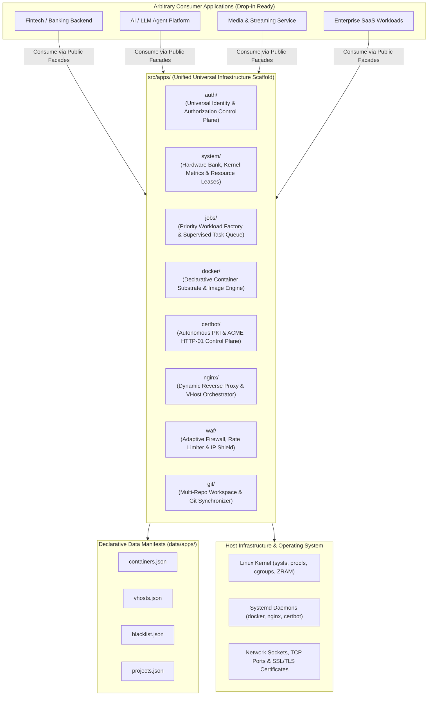

# Unified Universal Infrastructure Scaffold (`src/apps/`)

> **"Infrastructure as an Autonomous Substrate — Decoupled, Universal, and Reusable."**

`src/apps/` is not merely the infrastructure layer of a single application. It is architected as a **Unified Universal Infrastructure Scaffold & Control Plane Panel**—an enterprise-grade, domain-agnostic foundation designed to serve as the plug-and-play backend scaffold for hundreds of heterogeneous applications (fintech, SaaS, AI/ML agentic backends, streaming platforms, e-commerce, and high-concurrency microservices).

If domain-specific logic (`src/core/`, `src/services/`, and `src/routers/`) is entirely wiped out, `src/apps/` remains an autonomous, production-grade platform framework ready to power any modern system.

---

## 1. Architectural Philosophy



### Core Tenets of the Scaffold:

1. **Zero Domain Coupling (Universal Neutrality):**
   - Subsystems inside `src/apps/` possess zero knowledge of outer business models, database entities, or domain workflows.
   - All modules operate strictly on generic, strongly-typed contracts (`Pydantic v2`).

2. **Inversion of Control (IoC) & Permitted Flow:**
   - Downward import only. `src/apps/` never imports from `src/core/`, `src/services/`, or `src/routers/`.
   - External layers interact with `src/apps/` solely through exposed public manager facades (`SystemManager`, `JobManager`, `DockerManager`, `CertbotManager`, etc.).

3. **Data-Driven Declarative Execution:**
   - Subsystem behaviors are governed by JSON configuration manifests located in `data/apps/` (e.g. `containers.json`, `vhosts.json`), enabling instant runtime adaptation without codebase modifications.

4. **Fail-Fast Boundary Defense (The Tony Hoare Rule):**
   - Missing, malformed, or unauthorized input fails immediately at subsystem boundaries with typed `AppError` exceptions (`ValidationError`, `NotFoundError`, `AuthenticationError`). No silent fallbacks, backward aliases, or null-returning anti-patterns.

---

## 2. Universal Subsystems Overview

| Subsystem | Responsibility | Key Public Interface | Primary Storage / Manifest |
|:---|:---|:---|:---|
| [`auth/`](#1-auth-universal-identity--authorization-control-plane) | Cryptographic identity, RBAC, hardware tokens & session security | `AuthManager` / `get_auth_manager()` | In-memory vault / DB session |
| [`system/`](#2-system-host-os-hardware-supervision--resource-bank) | Host OS metrics, CPU/RAM/ZRAM supervision & resource leasing | `SystemManager` / `get_system_manager()` | `/proc`, `/sys`, Linux kernel |
| [`jobs/`](#3-jobs-priority-workload-factory--supervised-task-queue) | Multilane priority job queue, deduplication & SSE monitoring | `JobManager` / `get_job_manager()` | In-memory queue + events |
| [`docker/`](#4-docker-universal-container-substrate--image-engine) | Declarative container lifecycle, health checks & image pulling | `DockerManager` / `get_docker_manager()` | `data/apps/docker/containers.json` |
| [`certbot/`](#5-certbot-autonomous-pki--acme-certificate-plane) | Local X.509 inspection (< 1ms) & automated HTTP-01 ACME issuance | `CertbotManager` / `get_certbot_manager()` | `/etc/letsencrypt/live/` |
| [`nginx/`](#6-nginx-dynamic-reverse-proxy--vhost-orchestrator) | Dynamic upstream balancing, vhost generation & zero-downtime reloads | `NginxManager` / `get_nginx_manager()` | `data/apps/nginx/vhosts.json` |
| [`waf/`](#7-waf-adaptive-firewall-rate-limiter--ip-shield) | Sliding-window IP rate limiting, abuse detection & auto-banning | `WafManager` / `get_waf_manager()` | `data/waf/blacklist.json` |
| [`git/`](#8-git-multi-repo-workspace--git-synchronizer) | Automated multi-repository workspace cloning, fetch & branch sync | `GitManager` / `get_git_manager()` | `data/gitsync/projects.json` |

---

## 3. Subsystem Deep Dive

### 1. `auth/` (Universal Identity & Authorization Control Plane)
Provides an enterprise-grade, domain-agnostic identity, authorization, and cryptographic token management engine.
- **Stateless & Statefull RBAC:** Generates and cryptographically verifies JWT tokens (`HS256`/`RS256`) with strict signature checks, issuer verification, and immutable `Principal` context injection.
- **Hardware Token Vault:** Validates client hardware fingerprints, API keys, and device-bound security parameters.
- **Fernet Vault Encryption:** Encrypts sensitive secrets at rest with zero plaintext leaks.
- **Rotating Session Refresh:** Enforces single-use refresh tokens with automated reuse detection to prevent replay attacks.

### 2. `system/` (Host OS, Hardware Supervision & Resource Bank)
Acts as the central bank of system resources, preventing server saturation and cascade crashes under extreme concurrency.
- **Live Hardware Telemetry:** Low-overhead (< 2ms) non-blocking sampling of CPU saturation, memory pressure, active swap/ZRAM utilization, and disk I/O.
- **Dynamic Resource Leasing (`ResourceLease`):** Issues time-bound, cryptographically verified resource permits to workloads. When system pressure exceeds critical safety thresholds (e.g. RAM > 92%), new permits are rejected with immediate backpressure.
- **Hardware Circuit Breaker:** Detects hardware degradation (thermal throttling, GPU encoder faults) and transitions states (`CLOSED` → `OPEN` → `HALF_OPEN`) to protect host stability.

### 3. `jobs/` (Priority Workload Factory & Supervised Task Queue)
A multi-tier asynchronous workload supervision factory capable of executing background tasks with millisecond dispatch latency.
- **Multilane Priority Queueing:** Segregates tasks into dedicated execution lanes (`CRITICAL`, `HIGH`, `NORMAL`, `BACKGROUND`) with strict worker concurrency boundaries.
- **Content-Hash Deduplication:** Computes deterministic SHA-256 hashes of task specifications to automatically deduplicate redundant in-flight and recently executed jobs.
- **Resource Permit Injection:** Workers must hold an active permit from `SystemManager` before beginning execution, guaranteeing workloads never overwhelm host compute limits.
- **Real-Time SSE Telemetry (`live_monitor`):** Emits live progress, state transitions, and step metrics over HTTP Server-Sent Events with zero external broker requirements.

### 4. `docker/` (Universal Container Substrate & Image Engine)
Provides an autonomous virtualization control plane that manages containerized sidecars through declarative specifications.
- **Declarative Manifest Support:** Automatically ingests and validates container definitions from `data/apps/docker/containers.json` without modifying code.
- **Autonomous Host Provisioning:** Detects Docker engine and daemon health; automatically handles service restart and non-interactive installation.
- **Image Synchronization:** Synchronously pulls or initiates deduplicated background thread image downloads with completion callbacks (`background_pull: true`).
- **Socket Health Probing:** Never assumes a container is healthy simply because its process is running; actively verifies TCP socket responsiveness on target ports.

### 5. `certbot/` (Autonomous PKI & ACME Certificate Plane)
Decouples Public Key Infrastructure (PKI) and SSL/TLS certificate lifecycles from reverse proxies and containers.
- **Local Microsecond X.509 Inspection:** Reads on-disk PEM bundles directly via `cryptography.x509` to calculate expiration dates and remaining days in < 1ms without network roundtrips.
- **30-Day Renewal Invariant:** Enforces strict renewal policies (renewing only when missing, invalid, or `days_remaining <= 30`), preventing Let's Encrypt rate-limiting penalties (5 certs/week).
- **Zero-Cloud-Credential HTTP-01 Challenges:** Executes standard webroot ACME challenges (`/var/www/html/.well-known/acme-challenge`) requiring zero AWS, Cloudflare, or cloud IAM API credentials.
- **CLI Parameter Sanitization:** Validates domain inputs against RFC-compliant FQDN regexes to eliminate shell injection attacks.

### 6. `nginx/` (Dynamic Reverse Proxy & VHost Orchestrator)
Automates edge routing, SSL termination, and reverse proxying through programmatic configuration generation.
- **Dynamic Virtual Host Synthesis:** Formulates clean, hardened Nginx server blocks with HTTP-to-HTTPS redirects, HSTS headers, and optimized proxy buffering.
- **Zero-Downtime Hot Reloads:** Validates synthesized syntax (`sudo nginx -t`) prior to triggering zero-downtime daemon reloads (`sudo nginx -s reload`).
- **PKI Injection:** Integrates directly with `CertbotManager` to inject valid `CertificateBundle` certificates into SSL vhosts.

### 7. `waf/` (Adaptive Firewall, Rate Limiter & IP Shield)
Protects exposed endpoints from distributed brute-force attacks, scraping, and abusive traffic patterns.
- **Sliding-Window IP Rate Limiting:** High-throughput in-memory sliding log tracking request velocities across per-IP and per-subnet windows.
- **Adaptive Anomaly Mitigation:** Automatically identifies malicious traffic surges, bad actors, and malformed request probes.
- **Persistent Blacklist Enforcement:** Manages IP blacklists in `data/waf/blacklist.json` with dynamic expiry, returning immediate 403 Forbidden responses before application computation begins.

### 8. `git/` (Multi-Repo Workspace & Git Synchronizer)
Maintains synchronization between local file workspaces and remote git repositories.
- **Multi-Project Synchronization:** Reads project mappings from `data/gitsync/projects.json` and ensures branches are kept up-to-date with upstream remotes.
- **Conflict Isolation & Clean States:** Detects uncommitted changes, prevents dirty tree overwrites, and logs sync histories deterministically.

---

## 4. Integration Guidelines for New Applications

To adapt `src/apps/` as the infrastructure scaffold for a new application:

1. **Retain `src/apps/`, `src/config/`, and `src/helpers/`:**
   Keep the infrastructure scaffold intact.
2. **Define Declarative Infrastructure in `data/apps/`:**
   - Register required background containers in `data/apps/docker/containers.json`.
   - Configure public domains and upstreams in `data/apps/nginx/vhosts.json`.
   - Declare git repositories in `data/apps/gitsync/projects.json`.
3. **Build Domain Logic in `src/core/` and `src/services/`:**
   - Inject dependencies via standard Python constructors.
   - Example consuming the universal scaffold from a domain service:
     ```python
     from src.apps.docker import DockerManager
     from src.apps.system import SystemManager
     from src.apps.jobs import JobManager

     class BillingOrchestrator:
         def __init__(self) -> None:
             self.docker = DockerManager()
             self.system = SystemManager()
             self.jobs = JobManager()

         def bootstrap(self) -> None:
             self.docker.ensure_running("billing-redis")
             self.system.ensure_healthy()
     ```
4. **Register API Routes in `src/routers/`:**
   Expose HTTP endpoints guarded by `src.apps.auth` security dependencies.

---

## 5. Verification & Code Quality Standards

Every subsystem inside `src/apps/` must adhere strictly to the project's permanent architectural standards:

- **Zero Inline Comments & Docstrings:** Implementation files must rely solely on self-describing type hints and clean identifiers to minimize token consumption and maximize context-window density.
- **Strict AST Linter Compliance:**
  ```bash
  human-skills '{"tool_name": "linter", "tool_args": {"scan_path": "src/apps"}}'
  ```
  *Requirement: 0 violations, low coupling score.*
- **Sub-Engine Test Coverage:**
  ```bash
  PYTHONPATH=. pytest tests/apps/ -v --durations=0
  ```
  *Requirement: 100% passing test suites across all apps.*
