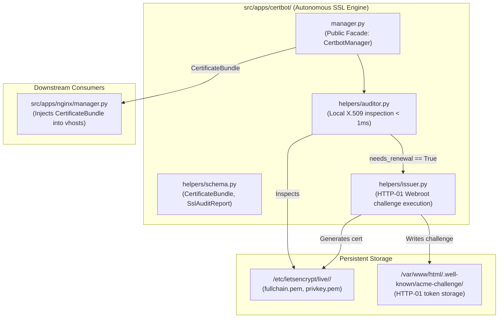

# certbot DOX

> *`src/apps/certbot/` acts as the "Autonomous PKI, Certificate Authority & ACME Control Plane":*
> *It decouples SSL/TLS certificate lifecycle management entirely from reverse proxies (Nginx) and container orchestration (`DockerManager`).*
> *It executes pre-flight local cryptographic inspections (< 1ms) and provisions automated Let's Encrypt certificates using HTTP-01 webroot challenges without requiring any third-party cloud API keys.*

## Purpose

- Own the `src/apps/certbot` Public Key Infrastructure (PKI) and ACME certificate provisioning domain.
- Provide strongly-typed Pydantic v2 data models (`CertificateBundle`, `SslAuditReport`) with zero fallback hacks.
- Perform local, microsecond X.509 certificate parsing (`cryptography.x509`) to evaluate validity, expiration timestamps, and days remaining without network calls.
- Enforce the **30-Day Renewal Invariant**: Certificates are only issued or renewed when missing or when `days_remaining <= 30`, preventing Let's Encrypt rate limits (5 certificates/week).
- Execute on-demand HTTP-01 ACME challenges via standard Nginx webroot (`/var/www/html/.well-known/acme-challenge`), requiring **zero AWS access keys** and zero external cloud credentials.
- Provide strict input sanitation against CLI parameter injection for domains and alternative names.
- Provide a clean Inversion of Control interface (`get_certificate(domain) -> CertificateBundle`) for consumption by `NginxManager` and downstream services.

## Architecture & Boundary Isolation

## Contracts & Invariants

1. **Zero Coupling with DockerManager**: `src/apps/certbot` does not import or depend on `DockerManager`.
2. **Zero Coupling with Nginx**: Certbot knows nothing of Nginx vhosts, templates, or proxies. Nginx consumes `CertificateBundle` via Dependency Injection.
3. **Fail-Fast Boundary Defense**:
   - `domain` must be a valid RFC-compliant FQDN. Empty or malformed domain strings raise `ValidationError`.
   - Missing certificate returns `CertificateBundle(status="NOT_FOUND", is_valid=False, needs_renewal=True, challenge_type="http-01")`.
   - Expired certificate returns `CertificateBundle(status="EXPIRED", is_valid=False, needs_renewal=True, challenge_type="http-01")`.
4. **Zero-Credential HTTP-01 Simplicity**:
   - Requires zero AWS access keys or IAM credentials.
   - Operates through standard HTTP port 80 webroot challenges.
