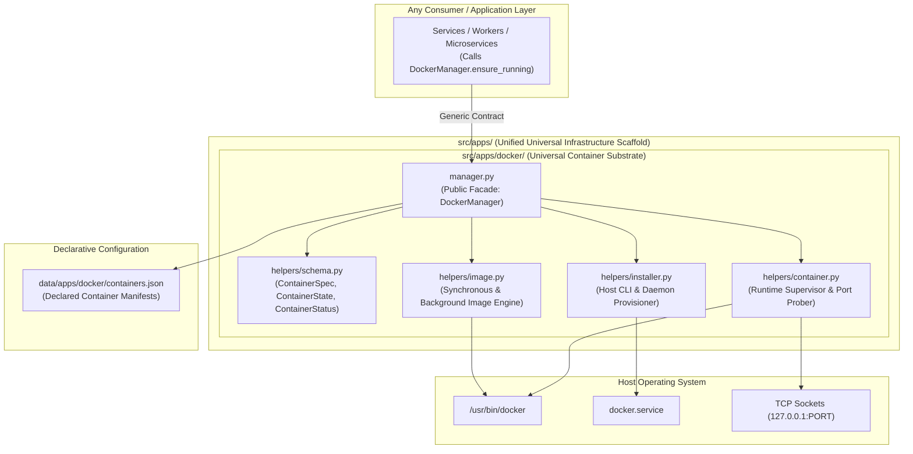

# docker DOX

> *`src/apps/docker/` acts as a "Universal Container Substrate & Lifecycle Control Plane":*  
> *It is a core component of the Unified Universal Infrastructure Scaffold—designed to be completely decoupled from any single business application.*  
> *It abstracts host virtualization, Docker daemon provisioning, image synchronization, and declarative container orchestration so that it can serve as the foundational container substrate for hundreds of heterogeneous backend applications.*

## Purpose

- **Universal Platform Substrate:** Provide a zero-coupling, reusable container orchestration engine for any modern backend architecture.
- **Declarative Infrastructure Contract:** Read and validate arbitrary container manifests from configuration (`data/apps/docker/containers.json`) using Pydantic v2 TypeAdapters.
- **Autonomous Host Provisioning:** Detect Docker CLI and daemon health; automatically restart systemd daemon services or trigger non-interactive host installations when missing.
- **Image Lifecycle Engine:** Inspect, cache, synchronously pull, or asynchronously background-download images with completion callbacks.
- **Resilient Self-Healing:** Manage port responsiveness, inspect container health, resume stopped containers, or cleanly recreate failed instances across bridge and host networking modes.
- **Universal Scaffold Neutrality:** Zero hardcoded container names, zero domain-specific shortcuts, and zero application-specific image references inside implementation code.

## Architecture & Boundary Isolation

## Public API (`DockerManager`)

- `reload_specs(self) -> None`: Re-reads and validates declarative specifications from `data/apps/docker/containers.json`.
- `get_spec(self, name: str) -> Optional[ContainerSpec]`: Retrieves declared specification for a given container.
- `is_docker_ready(self) -> bool`: Verifies both CLI installation and running daemon status.
- `is_docker_available() -> bool`: Static probe of host Docker availability.
- `is_image_available(self, image: str) -> bool`: Checks local Docker image cache.
- `trigger_background_pull(self, image: str, on_complete: Optional[Callable[[], None]] = None) -> None`: Initiates non-blocking background thread download.
- `ensure_running(self, name: str) -> bool`: Ensures the declared container is running and healthy on its configured port.
- `ensure_all(self) -> dict[str, bool]`: Bootstraps and health-checks all declared enabled containers.
- `stop_container(self, name: str, timeout: int = 5) -> bool`: Gracefully stops and de-registers a managed container.
- `stop_all(self) -> None`: Gracefully stops all containers initiated by the manager instance.
- `get_status(self, name: str) -> ContainerState`: Inspects real-time container status and socket responsiveness.

## Contracts & Invariants

1. **Pure Universal Neutrality:** `src/apps/docker` contains no hardcoded references to any specific application or container name.
2. **Configuration-Driven:** All sidecar definitions are supplied declaratively via `containers.json`.
3. **Fail-Fast Boundary Defense:** Unknown specs return `False` immediately; malformed specs fail Pydantic validation at boot.
4. **Port Health Invariant:** A container is not marked healthy until its listening TCP port actively accepts connections.
5. **Zero Docstrings / Inline Comments in Code:** Codebase adheres strictly to self-describing type hints and token-efficient clean code standards.
