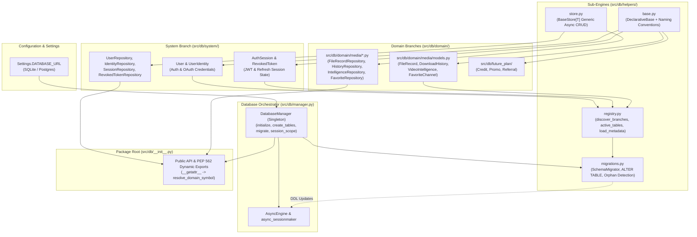

# db.py DOX

> *`src/db/` acts as the "Autonomous Multi-Branch Relational Persistence, Schema Registry & Self-Healing Migration Engine":*
> *It decouples persistent core authentication tables (`src/db/system/`) from plug-and-play business domain models (`src/db/domain/`) through dynamic schema branch discovery and PEP 562 lazy attribute resolution.*
> *It provides automated, zero-downtime DDL schema migrations, legacy table normalization, orphan table pruning, generic async CRUD primitives (`BaseStore[T]`), and centralized session scoping for all backend routers and services.*

---

## Purpose

- Own the `src/db` asynchronous relational database layer and public `DatabaseManager` orchestrator.
- Maintain complete architectural isolation between **System Schema** (`users`, `user_identities`, `auth_sessions`, `revoked_tokens`) and **Domain Schemas** (`download_history`, `favorite_channels`, `file_records`, `video_intelligence`, `daily_download_counts`).
- Ensure the system layer can initialize, migrate, authenticate, and run even if all domain directories are unmounted, missing, or deleted.
- Dynamically discover schema branches (`discover_branches`) by scanning `src/db/domain/*/models.py`, eliminating hardcoded domain table lists.
- Dynamically resolve domain models and repositories into top-level `src.db` namespace via PEP 562 `__getattr__` and `resolve_domain_symbol`.
- Provide zero-downtime, automated schema self-healing (`SchemaMigrator`):
  - Introspect live database catalogs via SQLAlchemy inspectors.
  - Automatically append missing columns via safe `ALTER TABLE ADD COLUMN` with compiled dialect types and default values.
  - Seamlessly migrate legacy flat user OAuth columns into the normalized 1-to-N `user_identities` table with temporary table staging and foreign key protection.
  - Detect and safely prune orphan domain tables when domain folders are removed from disk.
- Enforce strict SQL identifier validation (`^[a-zA-Z0-9_]+$`) on all dynamically generated DDL statements to prevent SQL injection.
- Expose generic, type-safe async CRUD repository operations (`BaseStore[T]`) for high-speed domain queries.
- Manage connection pooling (`create_async_engine` with `pool_pre_ping=True`), transactional session scopes (`session_scope()`), and FastAPI dependency injection (`get_session()`).

---

## Architecture & Data Flow



---

## Ownership

- `src/db/manager.py` owns the public facade, singleton instance lifecycle, engine initialization, session generators, and top-level migration triggers.
- `src/db/helpers/` owns database substrate helpers:
  - `base.py`: SQLAlchemy `DeclarativeBase` and standardized constraint naming conventions.
  - `registry.py`: Branch discovery, metadata loading, and active table introspection.
  - `migrations.py`: Self-healing schema migration engine and orphan pruner.
  - `store.py`: Reusable generic `BaseStore[T]` async CRUD repository.
- `src/db/system/` owns system authentication and authorization models and repositories (`models.py`, `repositories.py`).
- `src/db/domain/` owns domain-specific models and repositories (`media/`, etc.).
- `src/db/__init__.py` owns public exports and PEP 562 lazy domain symbol resolution.

### Class & Module Manifest

| Component | File Path | Responsibilities | Key Symbols / Methods |
|:---|:---|:---|:---|
| **`DatabaseManager`** | `src/db/manager.py` | Central singleton orchestrator managing AsyncEngine, sessionmaker, schema migrations, and ping. | `initialize()`, `reset_instance()`, `get_session()`, `session_scope()`, `create_tables()`, `migrate()`, `prune_orphans()`, `ping()`, `shutdown()` |
| **`SchemaMigrator`** | `src/db/helpers/migrations.py` | Introspects live tables against metadata, applies `ALTER TABLE ADD COLUMN`, normalizes legacy users, and detects/prunes orphans. | `run()`, `migrate_table()`, `detect_orphans()`, `prune_orphans()`, `_migrate_legacy_users()`, `_build_alter_sql()`, `_build_drop_sql()` |
| **`BaseStore[T]`** | `src/db/helpers/store.py` | Generic async repository providing standardized CRUD operations for any mapped entity model. | `get()`, `get_all()`, `count()`, `create()`, `update()`, `delete()`, `exists()` |
| **`Registry Helpers`** | `src/db/helpers/registry.py` | Scans directories for `models.py`, creates `SchemaBranch` objects, and tracks active vs orphan tables. | `discover_branches()`, `load_metadata()`, `active_tables()`, `system_table_names()`, `branch_tables()` |
| **`Declarative Base`** | `src/db/helpers/base.py` | Global `DeclarativeBase` with standardized constraint naming convention (`ix_`, `uq_`, `ck_`, `fk_`, `pk_`). | `Base`, `NAMING_CONVENTION`, `uuid_hex()`, `utc_now()` |
| **`System Repositories`** | `src/db/system/repositories.py` | System-level entity repositories inheriting from `BaseStore`. | `UserRepository`, `IdentityRepository`, `SessionRepository`, `RevokedTokenRepository` |
| **`System Models`** | `src/db/system/models.py` | System entity definitions for users, multi-provider identities, and session tokens. | `User`, `UserIdentity`, `AuthSession`, `RevokedToken` |
| **`Media Repositories`** | `src/db/domain/media/*.py` | Domain-level media data stores inheriting from `BaseStore`. | `HistoryRepository`, `FavoriteRepository`, `FileRecordRepository`, `IntelligenceRepository` |
| **`Media Models`** | `src/db/domain/media/models.py` | Domain entity definitions for media downloads, favorites, file records, and intelligence analytics. | `DownloadHistory`, `FavoriteChannel`, `FileRecord`, `VideoIntelligence`, `DailyDownloadCount` |

---

## Runtime Contracts & Invariants

### 1. System vs Domain Architectural Boundary
- The **System Branch** (`src/db/system/`) is permanent and mandatory. It must have **zero dependencies** on any domain branch.
- Domain branches (`src/db/domain/<branch>/`) are dynamic and modular. If a domain branch is deleted or unmounted, the application boots cleanly, authentication works without error, and `SchemaMigrator` flags the absent domain's tables as orphans in `last_orphans`.

### 2. Standardized Naming Convention
All tables mapped to `Base` adhere to the naming convention defined in `src/db/helpers/base.py`:
```python
NAMING_CONVENTION = {
    "ix": "ix_%(column_0_label)s",
    "uq": "uq_%(table_name)s_%(column_0_name)s",
    "ck": "ck_%(table_name)s_%(constraint_name)s",
    "fk": "fk_%(table_name)s_%(column_0_name)s_%(referred_table_name)s",
    "pk": "pk_%(table_name)s",
}
```
This guarantees cross-dialect compatibility (SQLite, PostgreSQL, MySQL) without auto-generated constraint collisions.

### 3. Self-Healing Schema Migrations (`ALTER TABLE ADD COLUMN`)
- During application startup (`_startup_apps()` in `main.py`), `DatabaseManager().migrate()` executes:
  1. Compares active mapped tables against database catalog tables.
  2. Creates new tables if missing.
  3. Checks columns of existing tables. Any column defined in Python models but missing from the database is added via `ALTER TABLE "{table}" ADD COLUMN "{col}" {type} [DEFAULT {val}]`.
  4. Runs legacy OAuth normalization: moves `users.google_id`, `access_token`, and `refresh_token` into the `user_identities` table.
  5. Computes orphan domain tables and stores them in `DatabaseManager.orphans`.

### 4. DDL Injection Defense
- Before executing any `ALTER TABLE` or `DROP TABLE` command, identifiers are checked against `_IDENTIFIER_PATTERN`:
  ```python
  if not _IDENTIFIER_PATTERN.match(table_name) or not _IDENTIFIER_PATTERN.match(col_name):
      raise ValidationError(f"Invalid identifier: {table_name}.{col_name}")
  ```
  This prevents malicious or accidental SQL injection through dynamic table or column names.

### 5. Session Scoping & Rollback Discipline
- Calling `session_scope()` ensures that any uncaught exception triggers `await session.rollback()` before re-raising, preventing transaction pollution.
- `DatabaseManager.initialize()` configures `expire_on_commit=False`, allowing ORM model attributes to be safely accessed after commits without triggering lazy-load detached instance errors.

---

## Notable Configurations (`src/config/settings.py`)

| Setting Key | Default Value | Description |
|:---|:---|:---|
| `DATABASE_URL` | `"sqlite+aiosqlite:///data/movie.db"` | Async database connection string. |
| `DATA_DIR` | `"data"` | Storage root for SQLite databases and filesystem caches. |

---

## Work Guidance

1. **Always Use `BaseStore[T]` for Repositories**:
   Avoid writing manual boilerplate queries. Extend `BaseStore[MyModel]` and add only custom domain-specific queries.
2. **Use `session_scope()` in Services & Workers**:
   For standalone scripts, background jobs, or CLI commands, use the async context manager:
   ```python
   async with session_scope() as session:
       repo = UserRepository(session)
       user = await repo.find_by_email(email)
   ```
3. **Use `Depends(get_session)` in Routers**:
   FastAPI endpoints should inject `AsyncSession` via FastAPI dependency injection:
   ```python
   @router.get("/users")
   async def list_users(session: AsyncSession = Depends(get_session)):
       repo = UserRepository(session)
       return await repo.get_all()
   ```
4. **Dynamic Domain Imports via `src.db`**:
   Import domain models and repositories directly from `src.db` (e.g. `from src.db import FileRecord, FileRecordRepository`). They are resolved dynamically via `resolve_domain_symbol`.
5. **No Direct `pathlib.Path` Imports**:
   Maintain strict architectural compliance: use `src.config` path utilities (`exists`, `is_dir`, `is_file`, `list_files`, `get_abs_path`) across all database modules.
6. **Logging**:
   All database operations log to `logs/db.log` using standard loggers (`db.manager`, `db.migrations`).

---

## Verification & Testing

- **AST Compliance Audit:**
  ```bash
  human-skills '{"tool_name": "linter", "tool_args": {"scan_path": "src/db"}}'
  ```
- **Database Test Suite (Domain Isolation, Migrations, Repositories, Stores):**
  ```bash
  PYTHONPATH=. pytest tests/db/ -v --durations=0
  ```

---

## Child DOX Index

- [manager.py](manager.py)
- [helpers/base.py](helpers/base.py)
- [helpers/registry.py](helpers/registry.py)
- [helpers/migrations.py](helpers/migrations.py)
- [helpers/store.py](helpers/store.py)
- [system/models.py](system/models.py)
- [system/repositories.py](system/repositories.py)
- [domain/media/models.py](domain/media/models.py)
