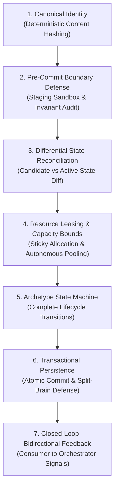
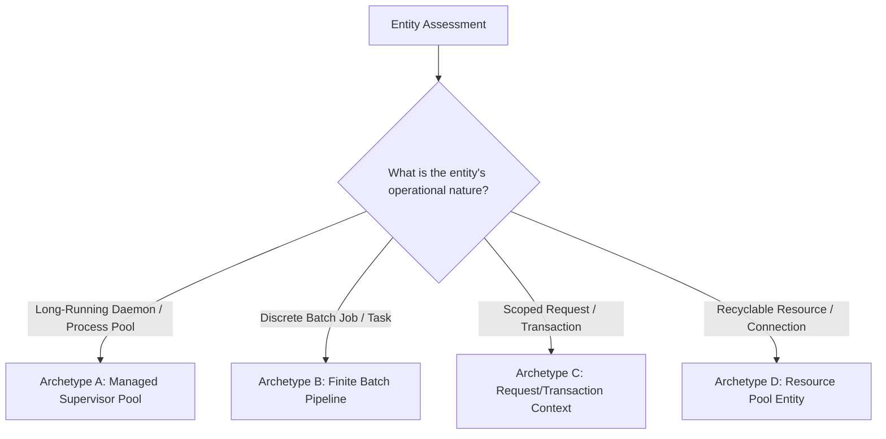
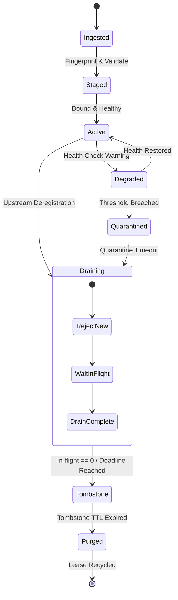
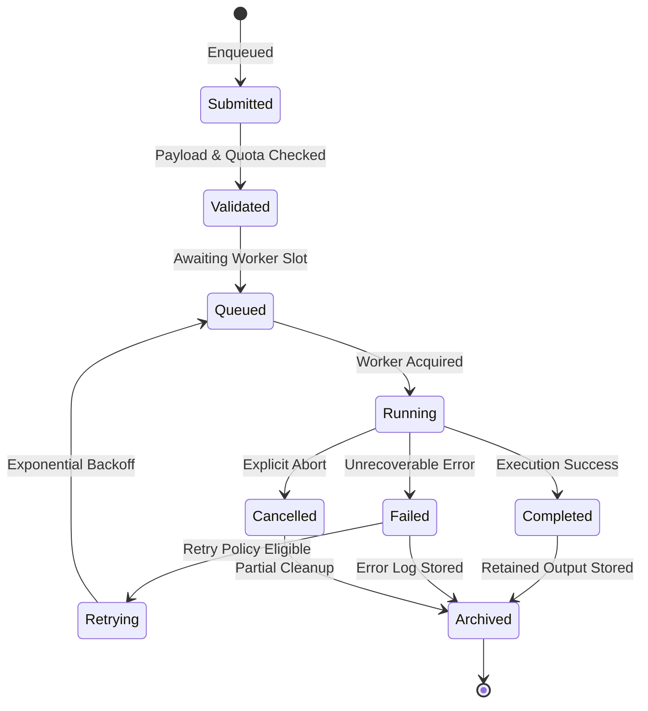
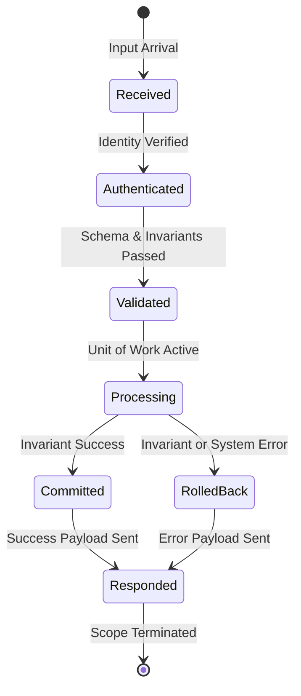
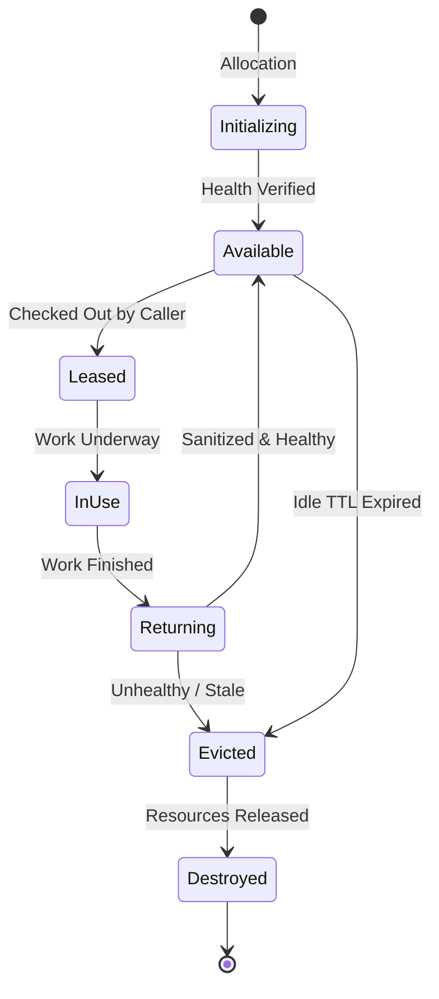

# Universal Feature Lifecycle & Workflow Design Methodology

> *"A software feature is not merely a function that executes; it is a state machine governing resources, identity, and invariants across time. True robustness begins at the sub-atomic lifecycle layer."*

---

## 1. Scope & Primary Directive

This skill does **NOT** design an entire generic application or high-level product MVP.  
Instead, it provides the universal, domain-agnostic methodology to design the **complete, end-to-end atomic and sub-atomic lifecycle for any specific, isolated functionality integration** (e.g., daemon supervisor, worker pool, batch job pipeline, database transaction context, autonomous connection pool, cache manager, or rate-limited service client).

Whenever an AI agent or software engineer is tasked with architecting, documenting, or reviewing a single functionality workflow, they must apply the **7 Invariant Pillars** and select the appropriate **Domain Archetype Profile** defined here.

---

## 2. Leverage the `human-skills` Gateway

Before designing or implementing, consult specialized capabilities within the `human-skills` ecosystem:

| Skill / Tool | Namespace | Purpose in Lifecycle Design |
| :--- | :--- | :--- |
| **`human-skills`** | Gateway | Master dispatcher to inspect available capabilities before assuming or improvising. |
| **`writing-plans`** | `obra_superpowers` | Structuring execution plans with exact file paths, test-driven steps, and zero placeholders. |
| **`test-driven-development`** | `obra_superpowers` | Formulating failing state transition and boundary tests prior to implementation. |
| **`linter`** | `my_skills` | AST-based architectural auditor to ensure unidirectional imports, sandboxing, and zero forbidden patterns. |
| **`mermaid_view`** | `my_skills` | Validating and rendering workflow and state-machine Mermaid diagrams. |

```bash
# Verify skills or inspect tools
human-skills --skill_info writing-plans
human-skills --tool_info linter
```

---

## 3. The 7 Universal Invariant Pillars

Every functionality integration must explicitly answer and architect these 7 dimensions, regardless of domain:



---

### Pillar 1: Canonical Identity & Deterministic Fingerprinting
- **The Anti-Pattern:** Using arbitrary runtime auto-increment IDs, random UUIDs, or unstable mutable labels to identify managed entities.
- **The Universal Standard:** Compute a deterministic SHA-256 fingerprint from the entity's immutable, normalized payload or configuration parameters:
  $$\text{Fingerprint} = \text{SHA256}(\text{CanonicalJSON}(\text{NormalizedImmutableAttributes}))$$
- **Guarantee:** 
  - Guarantees strict idempotency across restarts and repeated ingestion cycles.
  - Eliminates duplicate entities masquerading under different aliases, labels, or routing handles.

---

### Pillar 2: Pre-Commit Boundary Defense & Staging Sandbox
- **The Anti-Pattern:** Blindly writing raw input or newly spawned configurations directly into live production stores, runtime memory pools, or active pipelines.
- **The Universal Standard:** Validate the candidate entity completely **before** it touches live operational state:
  - **Schema & Invariant Check:** Strict Pydantic/type validation with zero-fallback Tony Hoare boundary defense.
  - **Dry-Run / Syntax Audit:** If the entity produces executable configs, scripts, or external specs, invoke an offline dry-run validation pass against an isolated `.tmp` buffer.
  - **Resource Pre-Check:** Verify resource availability (memory, ports, worker quota, disk space) before committing state.
- **Guarantee:** Invalid or corrupt configurations fail fast in isolation; active production execution is never halted by unverified inputs.

---

### Pillar 3: Differential State Reconciliation
- **The Anti-Pattern:** Destructive full overwrites on every sync cycle (tearing down the entire active pool and rebuilding from scratch), or concurrent reconciliation passes causing split-brain states.
- **The Universal Standard:** Compute set-theoretic differential state between Candidate Ingestion ($C$) and Active State ($A$):
  - **Concurrency Guard:** Enforce a non-reentrant state lock or optimistic concurrency control via monotonic version tags (`generation_id += 1`).
  - **Unchanged ($C \cap A$):** Retain entity and existing operational leases without interruption or connection drop.
  - **Added ($C \setminus A$):** Allocate required resource leases, stage in sandbox, and promote to active.
  - **Modified ($C \cap A$ with mutated payload):** Perform in-place hot-patch if supported; otherwise, execute a seamless blue-green rollover.
  - **Missing ($A \setminus C$):** Never terminate abruptly! Gracefully drain in-flight operations before releasing resources.

---

### Pillar 4: Resource Leasing, Quotas & Autonomous Pooling
- **The Anti-Pattern:** Unbounded allocation, volatile index-based slot assignment (`index + base`), or synchronous on-demand fetching inside hot caller loops causing latency spikes.
- **The Universal Standard:**
  - **Explicit Resource Leases:** Any scarce or shared resource (ports, GPU memory, worker threads, DB connections, rate tokens) must be managed through an explicit `LeaseManager` that issues unique, tracked lease tokens.
  - **Autonomous Pre-Warming (High-Latency Dependencies):**
    When upstream dependency provisioning introduces high latency (>1-2s), synchronous on-demand allocation inside user requests is strictly forbidden.
    - Maintain an autonomous background worker maintaining target warm capacity:
      $$N_{\text{target}} = \text{Peak Concurrency} \times \text{Safety Factor}$$
    - When available warm items drop below replenishment threshold ($T_{\text{replenish}}$), asynchronously replenish without blocking active consumers.
    - **TTL & Expiration Defense:** Prune stale entities according to proactive expiration buffers ($t_{\text{expiry}} - \Delta t_{\text{safety}}$).

---

### Pillar 5: Archetype State Machine Topologies

Do not force a single monolithic state machine onto every project. Select the appropriate **Archetype Profile** based on the entity's operational lifecycle:



#### Archetype A: Managed Supervisor Pool (Long-running Services & Daemons)
Designed for managed processes, proxy daemons, background workers, and persistent connections:


#### Archetype B: Finite Batch Pipeline (Jobs, Tasks & Transformations)
Designed for discrete work units, ETL tasks, video transcode jobs, and async commands:


#### Archetype C: Request / Transaction Context (APIs & Atomic Mutations)
Designed for HTTP requests, RPC calls, database units-of-work, and interactive operations:


#### Archetype D: Resource Pool Entity (Connections, Buffers, Tokens)
Designed for database connection pools, memory buffers, pre-warmed sessions, and tokens:


---

### Pillar 6: Transactional Persistence & Split-Brain Defense
- **The Anti-Pattern:** Sequential writes across multiple independent files. If the process crashes or disk fills after writing File A but before writing File B, the system enters an unrecoverable **split-brain state**.
- **The Universal Standard:**
  1. **Single-File Updates:** Write to isolated temporary buffer (`.tmp`), flush and sync (`os.fsync`), then execute an atomic file swap (`os.replace`).
  2. **Multi-File Updates:**
     - *Directory Pointer Swap:* Write all related files into a timestamped/versioned directory (e.g., `data/versions/v42/`), fsync, and update a single `current` symlink/pointer atomically.
     - *Write-Ahead Log (WAL) / Transaction Manifest:* Write an immutable transaction manifest declaring the commit intent. Only after manifest commit are changes applied. On restart, any half-written state is rolled back cleanly.
  3. **Crash Recovery:** On restart, always clean dangling `.tmp` buffers and resume strictly from the last verified snapshot.

---

### Pillar 7: Closed-Loop Bidirectional Feedback Contract
- **The Anti-Pattern:** One-way fire-and-forget architectures. The orchestrator produces configuration; consumers read it passively. When a consumer discovers an anomaly or failure, it has no channel to alert the orchestrator without triggering a costly full system restart.
- **The Universal Standard:** Establish an explicit event channel or callback interface:
  - **Consumer Anomaly Signal:** When an active entity encounters recurring runtime failures (e.g., connection reset, consecutive timeouts, poison payload), the consumer notifies the orchestrator: `orchestrator.notify_anomaly(entity_id, reason)`.
  - **Surgical Quarantine & Eviction:** The orchestrator transitions only that specific entity to `Degraded` or `Quarantined`, releases its lease, and provisions a replacement without recycling healthy peers.
  - **Circuit Breaker:** If pool-wide error rates breach thresholds, temporarily trip the circuit breaker and fall back to safe degradation mode.

---

## 4. Canonical Workflow Document Template (`docs/workflows/`)

When documenting any feature lifecycle, adhere to this standard layout:

```markdown
# [Component Name] Lifecycle & Workflow

## 1. Overview & Single Responsibility
[1 concise paragraph defining the boundaries: what it owns, what it isolates, and what it delegates.]

## 2. Selected Lifecycle Archetype
[State whether this is Archetype A (Daemon Pool), B (Batch Pipeline), C (Transaction Scope), or D (Resource Pool) and justify why.]

## 3. Sub-Atomic Invariant Guarantees
[Markdown Table mapping the 7 Invariant Pillars to project-specific guarantees.]

## 4. End-to-End Workflow Diagram
[Mermaid flowchart TD tracing: Trigger -> Ingestion -> Fingerprint -> Diff/Validation -> Execution -> Persistence -> Feedback.]

## 5. Lifecycle State Machine
[Mermaid stateDiagram-v2 illustrating complete states and transition guards for the chosen archetype.]

## 6. Failure Modes, Self-Healing & Invariant Checklist
[Markdown Table detailing specific failure modes, detection mechanism, and automated deterministic mitigation.]
```

---

## 5. Isolated Subsystem & File-by-File Implementation Sequence

1. **Enforce Single-Facade Subsystem Boundaries:**
   - Keep internal sub-engines and private worker units strictly isolated within their domain package (e.g., `src/<subsystem>/helpers/` or private modules).
   - Expose only a single public manager/orchestrator facade with an explicit, typed interface (`start()`, `stop()`, `execute()`, `notify_anomaly()`).

2. **The 5-Step Implementation Loop (One File at a Time):**
   - **Step 1 (Analyze):** Map *Current State* vs. *Target State*, identifying edge cases, concurrency boundaries, and data contracts.
   - **Step 2 (Implement):** Write clean, production-grade code adhering strictly to the Tony Hoare rule (no `None` returns, strict Pydantic schemas, typed exceptions). No docstrings or comments inside implementation code.
   - **Step 3 (Lint):** Run the architectural linter to verify zero forbidden imports, no raw `pathlib` outside `config/`, and strict single responsibility.
   - **Step 4 (Verify & Time):** Execute isolated unit tests asserting state machine transitions and boundary defenses.
   - **Step 5 (Orchestrate):** Validate the full end-to-end integration test verifying multi-component orchestration.

---

## 6. Cross-Platform Runtime & Concurrency Checklist

When auditing or designing any lifecycle engine, verify these 5 cross-platform invariants:

1. **Re-Entrant Cross-Platform File & State Locking:**
   - Avoid platform-locked POSIX calls (`fcntl.flock`) in portable code. Use cross-platform libraries (such as `filelock`) or database/Redis advisory locks with explicit timeouts and context managers to prevent thread/process self-deadlock.
2. **Lock-Free External I/O & In-Memory Rollback:**
   - Never hold a synchronization lock during external network or high-latency filesystem I/O. Perform pre-flight I/O outside critical sections, stage mutations in memory, and acquire locks solely for atomic state swaps.
3. **Cross-Platform Process Supervision & PID Verification:**
   - Never rely on `/proc/` paths or raw `os.kill(pid, 0)` which fail on Windows, macOS, and containers with PID recycling. Use cross-platform process management (such as `psutil`) to verify process creation time, status, and executable command line before signaling.
4. **Graceful Signal Handling Across Platforms:**
   - Handle termination signals (`SIGTERM`, `SIGINT`) gracefully. For background child processes, ensure clean shutdown protocols that allow active in-flight tasks to drain before forced termination.
5. **Structured Async Supervision & Thread Boundaries:**
   - Long-running orchestrators must offload blocking synchronous I/O via `asyncio.to_thread`. Implement cancellation tokens so `stop()` awaits in-flight tasks before concluding teardown.
